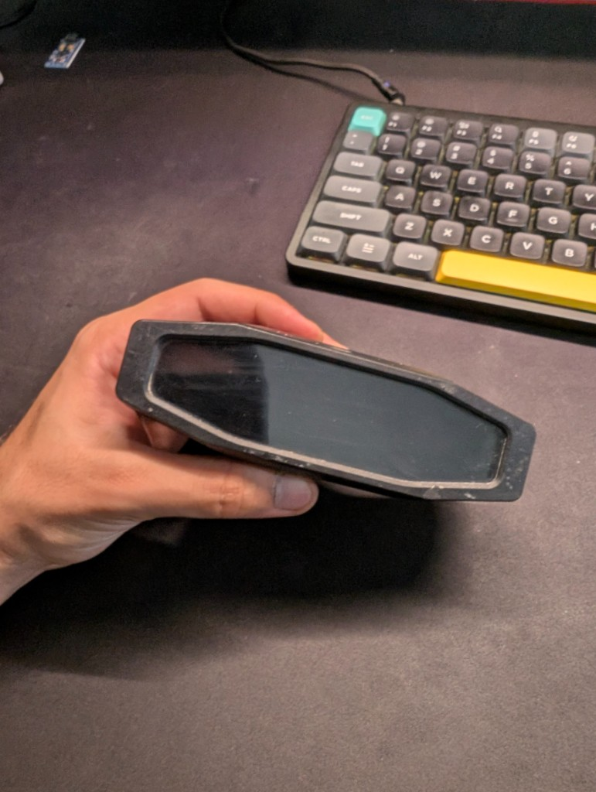
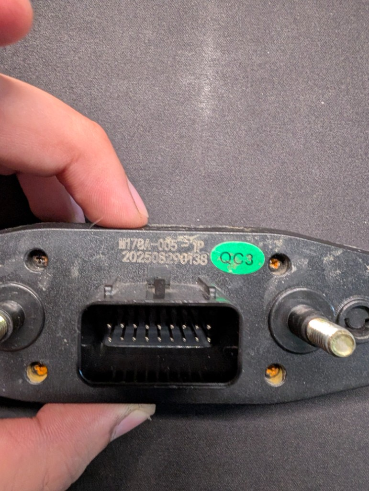
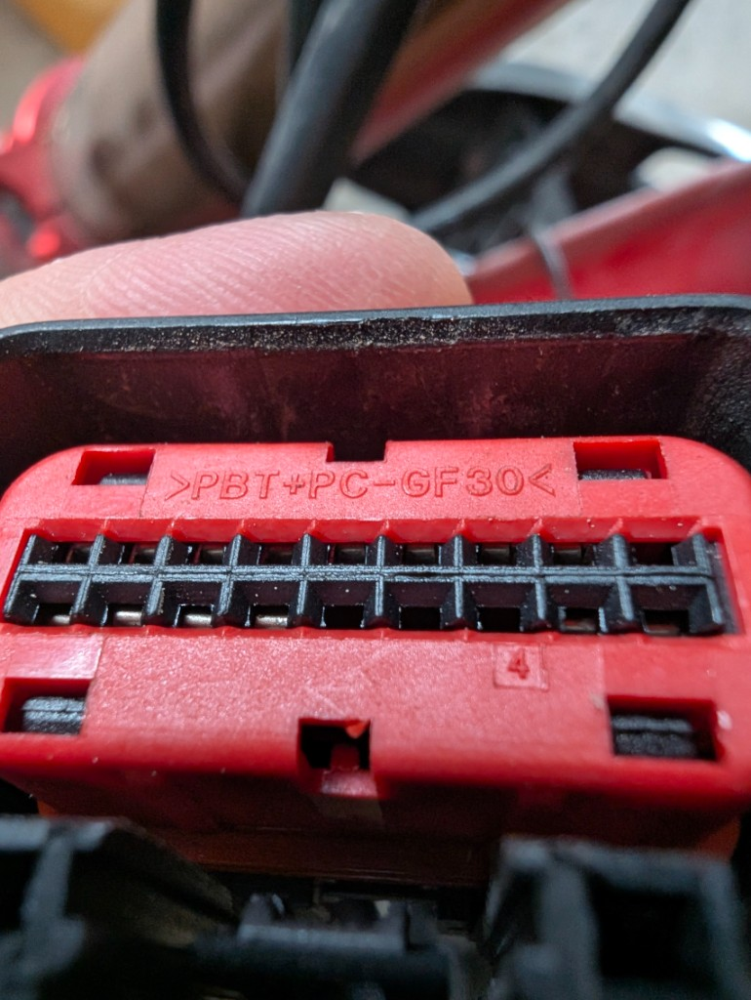
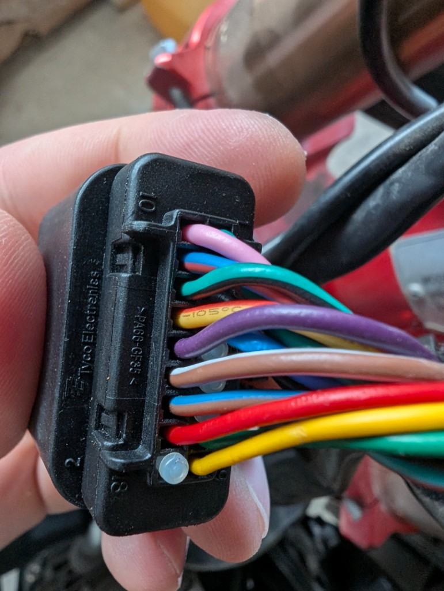
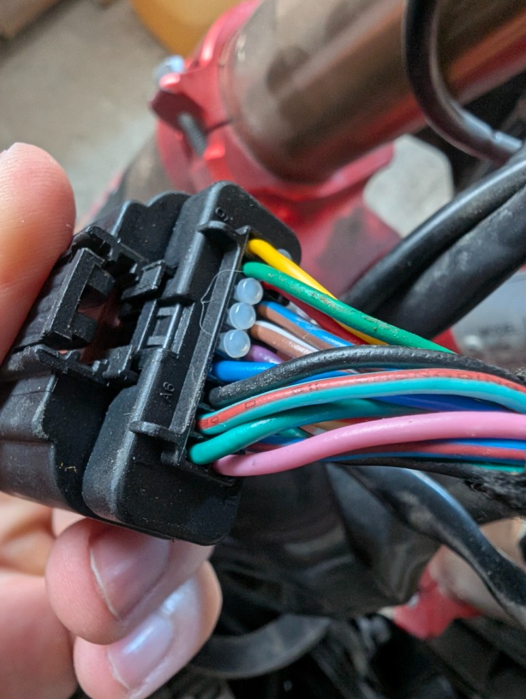
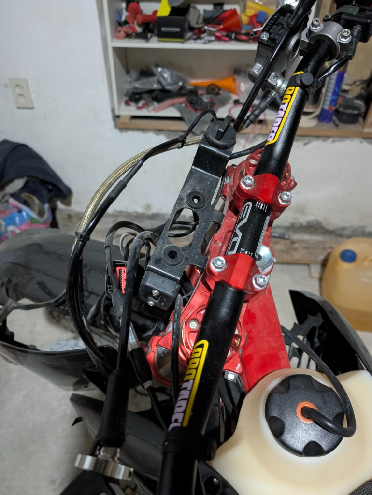

# Главный разъём M178A-005-1P

Фото и ориентиры по штатному коннектору приборки **Janxin M178A-005-1P** и ответной части жгута мотоцикла.

Полная электрическая таблица сигналов: **[HARDWARE.md](HARDWARE.md)** (раздел «Штатная приборка»).

Фото: `docs/photos/`.

---

## Что это за разъём

| | |
|--|--|
| Приборка | Janxin **M178A-005-1P** (партия `202508290138`, QC3) |
| Контакты | **18 pin**, 2×9 |
| Жгут (ответная часть) | **Tyco Electronics**, корпус `PA66-GF35`, красный insert `PBT+PC-GF30` |
| Где на байке | Под рулём у траверсы (слева от штока) |

На приборке — **штырьки (male)**. На жгуте — **гнёзда (female)**, чёрный корпус + красный insert.

---

## Ориентация и нумерация

Вид **со стороны проводов**. Ориентир: **зелёный (pin 1) и чёрный (pin 3) — сверху**.

На корпусе отлиты **10 / 1 / 9 / 18** — при такой ориентации метка **1** слева сверху, **10** слева снизу.

```
ВЕРХ:   1   2   3   4   5   6   7   8   9
НИЗ:   10  11  12  13  14  15  16  17  18
```

### Таблица разъёма (2 ряда)

| | 1 | 2 | 3 | 4 | 5 | 6 | 7 | 8 | 9 |
|--|---|---|---|---|---|---|---|---|---|
| **ВЕРХ** | **GND** масса | **N** нейтраль | **+12V** после зажигания | **HB** дальний | NC заглушка | NC | NC | ? TBD | ? SPEED? |
| цвет | зелёный | бирюз.+бордовая | **чёрный** | синий | — | — | — | зелёный | жёлтый |

| | 10 | 11 | 12 | 13 | 14 | 15 | 16 | 17 | 18 |
|--|----|----|----|----|----|----|----|----|----|
| **НИЗ** | **1** передача | **2** передача | **3** передача | **4** передача | **5** передача | **6** передача | **RPM** тахо | ? TBD | NC заглушка |
| цвет | розовый | син.+бордовая | бирюз.+чёрная | жёлт.+красная | фиолетовый | коричн.+белая | син.+коричневая | **красный** | — |

**На Arduino:** N/1…6 → GPIO (замыкание на pin1 GND).  
**Только через PC817:** pin 3 (+12V не на логику), pin 4 (HB), pin 16 (RPM). Pin 17/8/9 — не трогать.

---

## Фотоархив

### 1. Приборка — лицевая сторона



Штатная панель M178A (экран выкл.). Источник сигналов для кастомной приборки.

### 2. Приборка — задний разъём (male)



Задняя сторона корпуса: маркировка **M178A-005-1P**, штырьковый разъём 2×9, два крепёжных шпильки по бокам.

### 3. Жгут — ответная часть (female, mating face)



Красный insert + чёрный кожух. Вид на гнёзда. Материал insert: `>PBT+PC-GF30<`.

### 4. Жгут — сторона проводов, нумерация



Tyco Electronics / `PA66-GF35`. Видны отлитые номера полостей и цвета жил.

### 5. Жгут — сторона проводов, цвета



Тот же коннектор, другой ракурс. Белые/прозрачные вставки — **заглушки** пустых полостей (pins 5–7 и т.п.).

### 6. Место на мотоцикле



Разъём у красной траверсы, слева от рулевой колонки (вид сверху с места пилота).

---

## Распиновка (кратко)

| Pin | Сигнал | Цвет (типичный) | Статус |
|-----|--------|-----------------|--------|
| 1 | GND | зелёный | ✓ |
| 2 | Neutral N | бирюзовый + бордовая | ✓ |
| 3 | +12V после зажигания | чёрный | ✓ |
| 4 | дальний | синий | ✓ |
| 5–7 | заглушки | — | NC |
| 8 | ? | зелёный | TBD |
| 9 | ? (гипотеза SPEED) | жёлтый | TBD |
| 10 | 1 передача → **CHMCU A2** | розовый | ✓ |
| 11 | 2 → **A3** | синий + бордовая | ✓ |
| 12 | 3 → **A4** | бирюзовый + чёрная | ✓ |
| 13 | 4 → **A5** | жёлтый + красная | ✓ |
| 14 | 5 → **A6** | фиолетовый | ✓ |
| 15 | 6 → **A7** | коричневый + белая | ✓ |
| 16 | RPM | синий + коричневая | ✓ |
| 17 | ? | красный | TBD |
| 18 | заглушка | — | NC |

Передачи N/1–6: замыкание на **pin 1 (GND)**.  
**Нельзя** на Arduino/MCP напрямую: pin **3** (+12V), **4** (дальний), **16** (RPM) — только через **PC817**.

Подробности и схемы оптронов / MCP23017 → [HARDWARE.md](HARDWARE.md).

---

## Замечания по фото

1. **Pin 1 и pin 8** оба зелёные на жгуте — перед пайкой прозванивать.
2. **Чёрный = +12V (pin 3)**, не масса. Масса — зелёный pin 1.
3. Пустые полости закрыты белыми/серыми заглушками — это норма для 5–7 и 18.
4. Счётчик «дырок» на mating-face фото может визуально казаться 2×10 из‑за ключей/краёв; рабочая схема приборки — **18 контактов (2×9)**.
5. Дата съёмки жгута: 2026-08-29; приборки: 2026-08-28.
